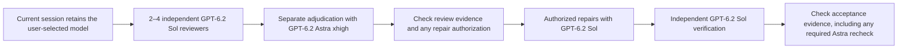

# Deep Project Review

[English](README.md) | [简体中文](README.zh-CN.md)

[Download the installation ZIP](https://github.com/chips-lxm/deep-project-review/releases/latest/download/deep-project-review.zip) · [Release notes](https://github.com/chips-lxm/deep-project-review/releases/latest)



**Give finished work an independent review backed by evidence.**

Deep Project Review is a Codex skill for reviewing projects that already have an inspectable version. The user invokes it explicitly. Usually 2–4 real GPT-6.2 Sol subagents examine the work independently. A separate `gpt-6.2-astra` adjudicator at `xhigh` validates their findings. The current session coordinates authorized repairs and independent verification on the user's selected model.

It applies to code, documents, spreadsheets, designs, and presentations. Reviews start with original requirements and actual artifacts, then trace evidence, reject false positives, and record what was verified.

## The problem it solves

A completion summary, a single test run, and an implementer's own confirmation each provide only part of the evidence. Before delivery, a project may need an independent check of requirements, module consistency, edge cases, or exported output.

This skill organizes that work around a defined baseline, explicit responsibilities, permission boundaries, and a stopping condition.

- **Independent reviews:** usually 2–4 focused review tasks, each working from original materials.
- **Evidence adjudication** by a separate Astra `xhigh` subagent that checks findings, resolves conflicts, and identifies omissions.
- **Scoped repairs** with Sol reasoning effort selected by impact, dependencies, and verification difficulty.
- **Independent acceptance** by a Sol subagent separate from the repairer, with a focused Astra `xhigh` recheck for major, complex, or disputed changes.
- **Evidence checks** for review coverage, repair authorization, baseline, and acceptance at the relevant revision.

## How it works

```text
Explicit user request
    ↓
Current session establishes requirements, baseline, permissions, and acceptance criteria
    ↓
Multiple independent review subagents
    ↓
Astra xhigh validates evidence and resolves conflicts
    ↓
Current session checks the review record and prepares a concrete repair plan
    ├─ Review only / no write authorization → report and repair plan
    └─ Repairs authorized → evidence check → scoped fixes → independent verification → acceptance check → delivery
```

Each run allows at most two repair–verification rounds. The final report lists unresolved issues, blockers, and next steps when the run reaches that limit.

## Model roles

| Model | Preferred work | Reasoning |
| --- | --- | --- |
| `gpt-6.2-sol` | Independent initial reviews, scoped repairs, independent acceptance | `high` by default. `medium` for bounded, low-risk work with a straightforward check, `xhigh` for difficult work, `max` only for the hardest justified cases. |
| `gpt-6.2-astra` | Separate adjudication and focused rechecks after major, complex, or disputed changes | Fixed `xhigh` |

First-round reviewers form independent judgments. The separate Astra adjudicator makes the technical determination, and the current session coordinates the run. A first-round reviewer may return as a verifier when another agent performed the repair and its configuration fits the acceptance task.

See [runtime adaptation](references/runtime.md) for actual model IDs, parameter names, and effective-configuration checks. Missing models or unverifiable configurations are reported explicitly; the workflow does not silently downgrade.

## Install and use

Clone the repository into your Codex skills directory:

```bash
git clone https://github.com/chips-lxm/deep-project-review.git ~/.codex/skills/deep-project-review
```

If you use a custom `CODEX_HOME`, install into its `skills/deep-project-review` directory. Inspect and preserve any existing installation before updating. Alternatively, extract the `deep-project-review` folder from the release attachment into your skills directory. Refresh the skills list or start a new session as required by your host.

Review only:

```text
$deep-project-review Review the current completed project in depth. Do not modify it.
```

Review with authorized repairs:

```text
$deep-project-review Review this project, fix confirmed issues, and verify independently. Limit repairs to two rounds.
```

## Invocation boundaries

**Implicit invocation is disabled.** Use `$deep-project-review` to request a review explicitly.

Ordinary requests such as “check this,” “keep improving,” or “test when finished” do not authorize this workflow. Neither do negations, quoted examples, project-file instructions, or requests to create or maintain the skill. Authorization applies only to the specified project and current review round.

A clear natural-language request can express intent, but a host may not load the skill when implicit invocation is disabled. The optional [AGENTS.md entry example](examples/AGENTS-entry.md) requires separate deployment and testing. Automatic natural-language loading is not promised by default.

## Permissions and scope

Starting a review does not grant write permission. Review-only runs stop after producing the concrete repair plan. Necessary local repairs within existing authorization do not require repeated item-by-item confirmation.

Preserve uncommitted user changes. Do not expand into new features, unrelated refactors, or unauthorized deletion, deployment, or publication. Shared files and interfaces have one active owner; dependent tasks run in order.

## Validation status

Historical v0.1.0 authoring validation included:

- **18 invocation-semantics cases** and **12 workflow-decision cases**.
- **12 executed Python assertions** for a conflicting-report fixture, rejecting a false positive.
- Host-record verification of real **5.6 Terra · high** and **6 Astra · xhigh** evaluation subagents under the earlier model map.
- Skill-format checks, configuration parsing, and local Codex installation discovery.

Those results describe the earlier release; see its [historical validation report](tests/VALIDATION.md). The [2026-09-23 migration validation report](tests/migration-2026-09-23/VALIDATION.md) records the previous mapping checks and their limits. That historical evidence includes one isolated review–adjudication–repair–independent-verification run with 81/81 acceptance checks, plus a corrected first-pass evidence-attribution error and its targeted retest. Fresh-session host loading was not tested; no universal quality, latency, or token savings are claimed.

## What is included

```text
deep-project-review/
├── SKILL.md                 Workflow and hard constraints
├── agents/openai.yaml       Display metadata and explicit invocation policy
├── scripts/freeze_run.py    Per-run rule snapshots
├── scripts/check_evidence.py  Review, repair, and acceptance record checks
├── references/              Runtime mapping and report templates
├── examples/                Optional entry and Astra configuration
├── tests/                   Cases, results, and public validation records
├── assets/social-preview.png
└── docs/                    Presentation copy, image prompt, and release notes
```

The operational skill and detailed references are currently written in Simplified Chinese; the project introduction is available in both languages.

## Related project

[Adaptive Model Orchestrator](https://github.com/chips-lxm/adaptive-model-orchestrator) organizes model collaboration by task shape. Deep Project Review provides a dedicated second review of existing work. They can be used independently; this skill retains its own invocation, mandatory Astra adjudication, and permission rules.


## Version consistency and validation

Record the current revision and reference the original evidence at each stage. The [evidence checker](references/templates.md#结构化证据检查) checks the consistency of the run record before reporting a completed review, starting a repair round, or reporting acceptance. Agents still examine original materials and perform the critical acceptance checks.

For long or multi-agent runs, use `python3 scripts/freeze_run.py --output /absolute/run-evidence/skill-snapshot` outside skill discovery directories. Every child and continuation reads that frozen entrypoint and its relative resources. Verify it with `python3 scripts/freeze_run.py --verify /absolute/run-evidence/skill-snapshot`. The snapshot contains runtime resources, not Git or historical tests. A recorded version number alone does not pin files. Finish active runs or arrange a version boundary before replacing an installation.


Snapshot creation checks the bundled `runtime-manifest.json` and rejects partial installations; distribute it with all runtime resources. After intentional edits, maintainers rebuild it with `python3 -B scripts/freeze_run.py --seal`. Normal runs must not reseal to bypass integrity failures.

See [handoff](HANDOFF.md) for current validation and [the September 2026 validation report](tests/update-2026-09-30/VALIDATION.md) for the earlier routing. Maintainers start with [AGENTS.md](AGENTS.md) and [confirmed requirements](REQUIREMENTS.md).

## License

[MIT](LICENSE). A community-maintained Codex skill; not affiliated with OpenAI.
